# Live Review: chart styles tried on real data, scored, and what to change

Aaron, 2026-11-03: *"try multiple chart styles and analyze them for effectiveness. research online for presentation hints and tips."*

This note does three things. It records the published guidance on choosing and styling charts for executive presentations, with the source and the claim each recommendation rests on. It draws the same real Marine FCU (1539, October 2026) figures in 42 alternative styles beside the 10 shipped charts, across 11 jobs, at the size Live Review really gives a chart, and scores each style against a fixed rubric. And it ends with a short list of changes to Live Review, each with an effort estimate.

Nothing in the product was changed. The gallery is a scratch prototype (it lives outside the repo; how it was made is at the end). The 61 screenshots in [`docs/chart-styles/`](chart-styles/) are the evidence; none carries a figure that is not already on Marine FCU's Live Review pages, and the peer charts carry anonymous values only (no client numbers, names or ids).

## Contents

1. [What the screen gives a chart](#1-what-the-screen-gives-a-chart)
2. [What the research says](#2-what-the-research-says)
3. [The rubric](#3-the-rubric)
4. [Results by job](#4-results-by-job)
5. [Colour and legibility, measured](#5-colour-and-legibility-measured)
6. [One default per job](#6-one-default-per-job)
7. [Changes to Live Review, in priority order](#7-changes-to-live-review-in-priority-order)
8. [What could not be verified](#8-what-could-not-be-verified)
9. [How the gallery was made](#9-how-the-gallery-was-made)

## 1. What the screen gives a chart

Measured on the shipped page, `?present=1`, windowed at 1280 x 720 (the size it is presented at):

| Fact | Value | Where it shows |
|---|---|---|
| Chart box (`.cbox`) | 1116 px wide, **222 to 266 px tall** depending on the screen | `J1A.png`, `J10A.png` |
| Horizontal bars | capped at **6 rows**; a 16-branch chart shows "Largest 6 of 16" | `barsSVG`, `room` |
| Default order while presenting | largest first (`sortOf` returns `desc` for more than 6 categories) | so the 10 branches that need coaching are the ones not drawn |
| Type | category labels 16 px, axis ticks 13 px, value labels 15 px | `html.present .chart text` |
| Palette | navy, orange, steel, teal, gold, grey; a donut cycles through six | `PAL` in `live.js` |

Two consequences drive most of what follows. A chart that needs more than about 250 px of height or more than six or seven labelled rows does not fit as drawn, and a style has to earn its marks inside that box. And because the default view shows the largest values first, a screen whose question is "which branches are below the book" opens on the branches that are not.

## 2. What the research says

Sources are listed with what I read and how far I could check it. "Read" means I opened the page or PDF and read the passage; "summary only" means I saw it quoted or summarised in a search result and did not open the original.

| # | Source | What it says (the claim relied on) | Checked |
|---|---|---|---|
| 1 | Cleveland and McGill, "Graphical Perception," *JASA* 79(387), 1984, doi:10.1080/01621459.1984.10478080. Read through [Cornell INFO 3312 slides](https://info3312.infosci.cornell.edu/slides/04-graphical-perception.html) | Viewers judge position along a common scale most accurately, then position on non-aligned scales, then length, direction and angle, then area, then volume, and shading or colour saturation last. | Secondary (the paper itself was not opened) |
| 2 | Heer and Bostock, "Crowdsourcing Graphical Perception," CHI 2010, [PDF](https://homes.cs.washington.edu/~jheer/files/2010-MTurk-CHI.pdf) | Replicates the ranking with crowd workers and adds circular area (bubbles) and rectangular area (treemaps), which rank below position, length and angle. | Abstract and headings; results tables did not extract |
| 3 | Few, ["Bullet Graph Design Specification"](https://www.perceptualedge.com/articles/misc/Bullet_Graph_Design_Spec.pdf), 2013 | One measure, a comparative marker, two to five qualitative bands, ideally three; the featured measure is a bar, and a dot or X when the scale starts above zero. Replaces gauges on dashboards. | Read |
| 4 | Few, ["Save the Pies for Dessert"](https://www.perceptualedge.com/articles/visual_business_intelligence/save_the_pies_for_dessert.pdf), 2007 | A pie is judged accurately only near 0, 25, 50, 75 and 100 per cent; once values are added to each slice it is a table in a circle; a sorted bar chart on a percentage scale carries the part-to-whole message and the comparison. | Read (first pages) |
| 5 | Wilke, [*Fundamentals of Data Visualization*](https://clauswilke.com/dataviz/), 2019: [amounts](https://clauswilke.com/dataviz/visualizing-amounts.html), [proportions](https://clauswilke.com/dataviz/visualizing-proportions.html), [colour pitfalls](https://clauswilke.com/dataviz/color-pitfalls.html), [redundant coding](https://clauswilke.com/dataviz/redundant-coding.html), [context](https://clauswilke.com/dataviz/balance-data-context.html), [telling a story](https://clauswilke.com/dataviz/telling-a-story.html) | Bars start at zero; dot plots may use a non-zero axis; sort unordered categories by value; stacked bars make middle segments hard to compare; side-by-side bars handle many parts well; qualitative colour scales work with three to five categories and are unmanageable past eight; do not rely on colour alone, label directly and aim for figures that need no legend; one reference line is the minimum context; for slides show a simplified subset first and keep a story to three to six figures. | Read |
| 6 | Financial Times, [Visual Vocabulary](https://github.com/Financial-Times/chart-doctor/blob/main/visual-vocabulary/README.md) | Charts are chosen by the relationship they show. Deviation: diverging bars. Ranking: ordered bar, dot strip plot, lollipop, slope. Part-to-whole: stacked, pie, donut, treemap, waffle. Change over time: line, column, slope, connected scatter. Correlation: scatter, bubble. Distribution: histogram, dot strip plot. | Read |
| 7 | Datawrapper, [chart-type guide](https://www.datawrapper.de/blog/chart-types-guide) and [why bars start at zero](https://www.datawrapper.de/academy/why-our-column-and-bar-charts-start-at-zero) | Bar charts suit category comparison; a small gap is easier to see in a bar than in a pie or donut; treemaps are harder to read; a truncated bar axis misleads, so use a dot plot (no filled bar, so no implied zero) or a line when the range does not start at zero; small multiples instead of tabs. A figure of "about five slices" at most appeared in a search snippet from the academy, not in a page I could open. | Read, except the slice limit |
| 8 | Knaflic, Storytelling with Data: [dot plot vs slopegraph vs bar](https://www.storytellingwithdata.com/blog/2017/10/13/novel-vs-the-boring-old-bar-chart), [when bars win and when lines do](https://www.storytellingwithdata.com/blog/when-bars-winand-when-lines-do) | Bars are the reasonable default for comparing absolute values; lines, slopegraphs and dot plots win when the point is change or a gap; "simple often beats sexy"; the audience's familiarity matters. Her pie and donut posts (["death to pie charts"](https://www.storytellingwithdata.com/blog/2011/07/death-to-pie-charts), [alternatives](https://www.storytellingwithdata.com/blog/2014/06/alternatives-to-pies)) recommend sorted horizontal bars. | First two read; pie posts summary only |
| 9 | Franconeri, Padilla, Shah, Zacks and Hullman, "The Science of Visual Data Communication," *Psychological Science in the Public Interest* 22(3), 2021, [page](https://www.psychologicalscience.org/publications/visual-data-communication.html) | Convert legends into direct labels; start all-grey and colour only the marks that carry the point; break dense graphs into small multiples with shared axes; zero baselines are not always the right choice; mapping numbers to hues can exaggerate differences; avoid distracting animation. | Read (summary page) |
| 10 | Robertson, Fernandez, Fisher, Lee and Stasko, "Effectiveness of Animation in Trend Visualization," *IEEE TVCG* 14(6), 2008, [Microsoft Research](https://www.microsoft.com/en-us/research/?p=145396) | For analysis, small multiples were more accurate and both static views faster than animation; animation did better in a presentation setting. | Summary only |
| 11 | Haroz, Kosara and Franconeri, "The Connected Scatterplot for Presenting Paired Time Series," *IEEE TVCG* 22(9), 2016, [abstract](https://www.tableau.com/research/publications/connected-scatterplot-presenting-paired-time-series) | Low-complexity connected scatterplots can be understood with little explanation; the authors also documented common misreadings. | Abstract only |
| 12 | Few, *Information Dashboard Design*; summarised in the [UXmatters review](https://uxmatters.com/mt/archives/2007/04/book-review-information-dashboard-design.php) | A dashboard keeps its most important information on one screen, because short-term memory is limited; the first of his thirteen mistakes is exceeding the screen. | Secondary |
| 13 | Cowan, "The magical number 4 in short-term memory," *Behavioral and Brain Sciences* 24(1), 2001 | Central capacity is about four chunks, not seven. Used here only as the reason to hold the marks a viewer must track to a handful. | Summary only |
| 14 | W3C, [WCAG 2.1 Understanding 1.4.11, Non-text Contrast](https://www.w3.org/WAI/WCAG21/Understanding/non-text-contrast.html) | Bars, lines and slices a viewer needs to read a chart need 3:1 contrast against their background, and slices that must be told apart need a border if they are under 3:1 from each other; values given as text reduce what has to meet the test. | Summary only |
| 15 | Okabe and Ito, [Color Universal Design](https://jfly.uni-koeln.de/color) (the "Okabe-Ito" palette) | Eight colours chosen to stay distinguishable under the common forms of colour-vision deficiency. | Summary only |
| 16 | Tufte, *The Visual Display of Quantitative Information*, 1983 (data-ink ratio, small multiples) | Maximise the data-ink ratio "within reason" (Wilke's reading of it); small multiples pay the cost of learning a design once. | Through Wilke and secondary pages |
| 17 | Callahan and Associates, [percentile and star scoring in peer analysis](https://callahan-associates-inc.helpscoutdocs.com/article/215-performance-analysis-text-in-peer) | The credit-union peer tools rank an institution by percentile within a peer set, warn that a rank says nothing about absolute performance, and say the peer group chosen changes the story. | Summary only |
| 18 | Microsoft Tech Community thread, [video quality for screen sharing](https://techcommunity.microsoft.com/t5/microsoft-teams/increase-video-quality-for-screen-sharing/m-p/3048694) | A community responder says shared content is limited to 1080p; users report small text blurring and a low frame rate when nothing moves. | Forum posts, not Microsoft documentation |

What I could not find: a source on font sizes for a shared screen that is better than vendor blog posts (they cluster at 18 to 24 pt for slides), so no size in section 7 rests on one. I treated the Teams point as a risk to test (section 5), not as a finding.

### What the sources add up to

1. **Put the comparison on a common scale.** Position beats length, length beats angle, angle beats area (sources 1, 2). Dots, bars and lines read more accurately than donuts, treemaps and bubbles.
2. **Bars start at zero; dots need not.** A filled bar implies zero, so truncating it misleads; a dot or lollipop head on a labelled non-zero axis does not (sources 5, 7, 3). This matters here because several Live Review rates cluster between 85 and 99 per cent.
3. **Sort, and let the order carry the story.** Unordered categories go by value (source 5); the question the screen answers decides which end comes first.
4. **Few parts in a whole, and values beside the shape.** Pies and donuts are read well near quarters and halves and poorly otherwise; once labels are added the picture is a table (sources 4, 5, 8, 7). Side-by-side or ranked bars handle many parts.
5. **Colour carries meaning, not decoration.** Grey the context, colour the mark that carries the point; three to five categories; never colour alone (sources 5, 9). Check contrast and colour-vision safety (sources 14, 15).
6. **Direct labels beat legends** (sources 5, 9), and one reference line (a goal, a median) is the minimum context a bare mark needs (source 5).
7. **For change, show change.** Slope and dumbbell charts show the gap between two points; a line shows a path; bars show a level (sources 6, 7, 8).
8. **Break up, do not pile on.** Small multiples with shared axes read faster than a toggle or an animation for comparison (sources 5, 9, 10); a presentation shows a simplified subset first (source 5).
9. **Limit what the eye must track.** About four chunks of attention (source 13) and one screen per message (source 12). Here that means one chart per slide, a handful of named marks, and the rest a keypress away, which is how Live Review's present mode already works.
10. **Benchmarks are ranks plus a reference.** Peer tools show a percentile and a median and caution that rank is relative (source 17), so the screen says how many peers and which measure, and does not imply a target.

## 3. The rubric

Fixed before scoring. Each style gets 1 (poor) to 5 (strong) on nine criteria; the weighted total is shown out of 100 (weighted sum divided by 95).

| Criterion (column) | Weight | What a 5 means |
|---|---|---|
| Accuracy of the comparison (Acc) | 3 | The viewer judges values by position on a common scale (source 1) |
| Legibility at 1280 x 720 over a share (Leg) | 3 | Type stays at or above the shipped sizes, marks are large, and the chart fits the 222 to 266 px box |
| Marks and clutter (Marks) | 2 | Few marks and labels; the viewer is not asked to track more than a handful |
| Labelling effort (Label) | 1 | Labels place themselves without collisions or hand-set rules |
| Colour-blind safety and contrast (Col) | 2 | Meaning survives simulated colour-vision deficiency and the 3:1 mark test, or is also carried by position or a label |
| Honesty (Hon) | 3 | Bars start at zero; a non-zero axis is on a dot only and labelled; nothing hidden that changes the reading. The project's own rules count: a month left out must stay visible, a derived number must be traceable, movement words follow the +/-2% band and complete months only |
| Supports a spoken "so what" (So-what) | 3 | The finding is visible without the presenter explaining how to read the chart |
| Drill-down fit in Live Review (Drill) | 1 | A click or the existing sort and metric controls still work |
| Build cost (Cost) | 1 | 5 is already shipped or a few lines; 1 is a new renderer plus backend and audit work |

The scores are my judgement against these definitions, not user testing. The honesty column is a gate in spirit: where a style fails it badly (a truncated bar, a hidden left-out month) I scored it 1 or 2 and say so.

## 4. Results by job

Each job draws one real Marine FCU data set in several styles. "Shipped" images (the `A` of each job) are crops of the real Live Review page in present mode, except J4A (no real screen has 16 parts, so it is the shipped donut logic redrawn) and J8A (redrawn on the monthly measure so all three styles share data); the others are the gallery at the same 1116 px width. Tables use the column names above.

### Job 1. Compare 16 branches on one rate

*Question: which branches sit below the book's debit take?* Data: debit take rate on accounts opened in the last 12 months (`take-chart`), 16 branches, 81% to 99%, book 91.3%.

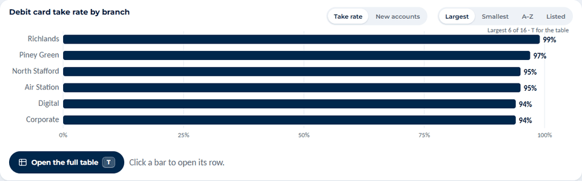
**J1A, as shipped.** Six bars, largest first. Everything shown is between 94% and 99%, and from zero those bars are the same length to the eye. The four branches below the book (Stone Bay 89%, Russell Road 89%, Wilmington 87%, Call Center 81%) are not on the slide.

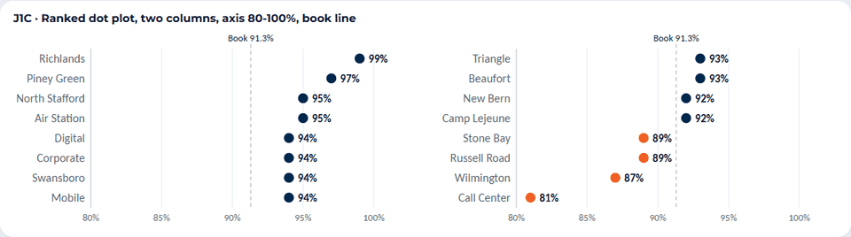
**J1C, ranked dot plot** on an 80 to 100% axis with the book line, two columns, below-book dots in orange. All 16 fit in 248 px.

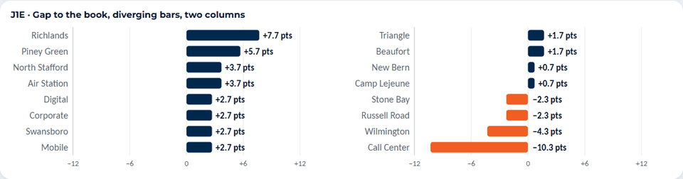
**J1E, gap to the book** as diverging bars (derived points above and below 91.3%).

| Style | Acc | Leg | Marks | Label | Col | Hon | So-what | Drill | Cost | Score |
|---|---|---|---|---|---|---|---|---|---|---|
| J1A Horizontal bars from zero, top 6 of 16 (shipped) | 3 | 5 | 5 | 5 | 5 | 3 | 2 | 5 | 5 | **78** |
| J1B Sorted bars from zero, all 16, rotated names | 3 | 3 | 3 | 3 | 4 | 5 | 3 | 4 | 4 | **71** |
| J1C Ranked dot plot, two columns, 80-100% axis, book line | 5 | 4 | 3 | 5 | 4 | 4 | 5 | 4 | 3 | **84** |
| J1D Lollipop from zero, two columns | 3 | 4 | 3 | 5 | 4 | 5 | 3 | 4 | 3 | **75** |
| J1E Gap to the book, diverging bars, two columns | 5 | 4 | 3 | 5 | 4 | 4 | 5 | 4 | 2 | **83** |
| J1F Dot strip of all 16, four lowest named | 5 | 3 | 5 | 3 | 4 | 4 | 4 | 2 | 3 | **78** |

Other images: [J1B](chart-styles/J1B.png), [J1D](chart-styles/J1D.png), [J1F](chart-styles/J1F.png).

**Finding.** When values cluster near the top of the scale, bars from zero (J1A, J1B, J1D) spend 80% of their length on a range with no information; a dot on a labelled 80 to 100% axis uses the space for the difference. The lollipop from zero has the same problem as the bar. J1E scores nearly as high but needs a derived figure (the gap) in the pack. **Default: J1C.** Offer J1E as the "so what" view when the presenter wants the gap in points.

### Job 2. Compare 32 branches

*Question: which branches earn the least per account?* Data: value per account a year (`gap-chart`), 32 branches, $5 to $365.

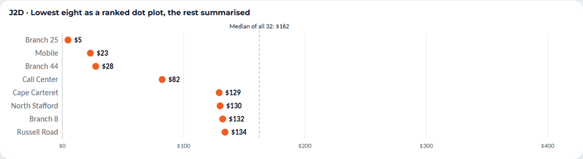
**J2D, the lowest eight as ranked dots** with the median of all 32.

| Style | Acc | Leg | Marks | Label | Col | Hon | So-what | Drill | Cost | Score |
|---|---|---|---|---|---|---|---|---|---|---|
| J2A Horizontal bars, top 6 of 32 (shipped) | 5 | 5 | 5 | 5 | 5 | 3 | 3 | 5 | 5 | **87** |
| J2B Dot strip, five lowest and three highest named | 5 | 3 | 4 | 3 | 4 | 4 | 5 | 2 | 3 | **79** |
| J2C Ranked dots across, all 32, ends named | 5 | 3 | 3 | 4 | 4 | 5 | 4 | 3 | 3 | **79** |
| J2D Lowest eight as ranked dots with the median | 5 | 4 | 5 | 5 | 4 | 4 | 5 | 4 | 3 | **88** |

Other images: [J2A](chart-styles/J2A.png), [J2B](chart-styles/J2B.png), [J2C](chart-styles/J2C.png).

**Finding.** Here the shipped bars are sound: dollars with a wide spread read well from zero. What is wrong is the order. Opening on the six largest answers "who earns most", and the screen is about the ones that earn least; the shipped **Smallest** button already gives the right view, one press away. J2D adds only the median line and a count ("lowest 8 of 32"). All 32 cannot be drawn with readable labels in 250 px at any style tried (J2B and J2C show it); the answer is to show the end that matters and keep the rest in the table. **Default: shipped bars with the lowest first and a median line**; J2D is the same idea as dots.

### Job 3. Parts of a whole: four parts, one dominant

*Question: how are CashPlease loans split by status?* Data: `cp-status-donut`, 6,235 paid off, 367 funded, 326 charged off, 61 overdue.

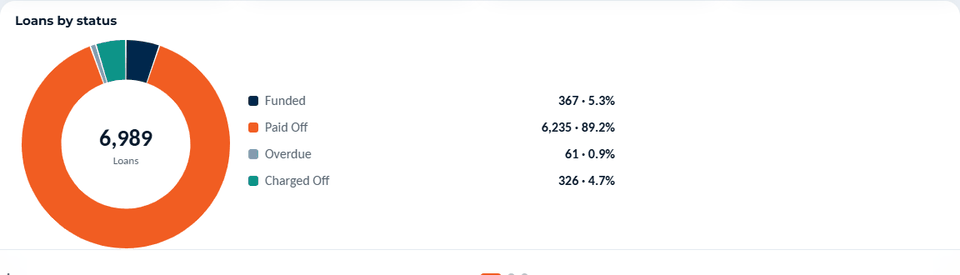
**J3A, as shipped:** donut with a legend. The 61 overdue loans are a sliver.

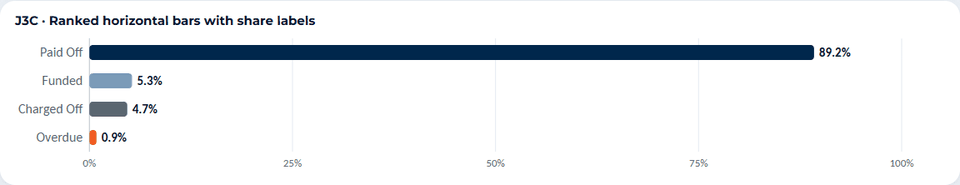
**J3C, ranked bars with share labels.**

| Style | Acc | Leg | Marks | Label | Col | Hon | So-what | Drill | Cost | Score |
|---|---|---|---|---|---|---|---|---|---|---|
| J3A Donut with legend (shipped) | 2 | 4 | 4 | 4 | 4 | 4 | 3 | 3 | 5 | **71** |
| J3B Single 100% stacked bar, direct labels | 4 | 4 | 5 | 3 | 4 | 5 | 4 | 2 | 3 | **81** |
| J3C Ranked bars with share labels | 5 | 5 | 5 | 5 | 5 | 5 | 4 | 5 | 5 | **97** |
| J3D Treemap | 2 | 3 | 4 | 2 | 4 | 4 | 2 | 3 | 2 | **59** |
| J3E Waffle, 100 squares | 3 | 4 | 2 | 3 | 4 | 4 | 4 | 1 | 3 | **67** |

Other images: [J3B](chart-styles/J3B.png), [J3D](chart-styles/J3D.png), [J3E](chart-styles/J3E.png).

**Finding.** This agrees with sources 4, 5, 7 and 8. The donut reads "most loans are paid off", which the legend already says; it cannot show whether overdue (0.9%) is smaller than charged off (4.7%) without the numbers. Ranked bars show all three small parts on one scale and are already a shipped block type. The donut's palette also colours the benign status (Paid Off) orange and the problem status (Overdue) steel, the reverse of the way orange is used elsewhere on the page ([`J3A-deut.png`](chart-styles/J3A-deut.png) shows it under simulated deuteranopia). The treemap leaves the smallest rectangle unlabelled; the waffle rounds to whole squares. **Default: J3C.** Keep the donut as a selectable alternative under conditions (section 6), since Aaron asked for it on 2026-11-03.

### Job 4. Parts of a whole: sixteen parts

*Question: where do the new eligible accounts open?* Data: the take-chart "New accounts" metric, 16 branches, 4,430 accounts listed.

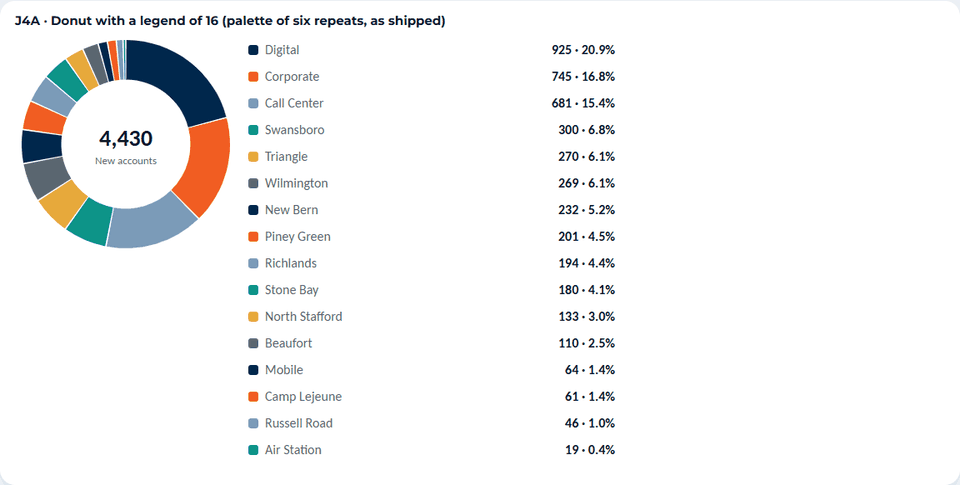
**J4A, the shipped donut logic on 16 parts.** The legend is 528 px tall (the box is 250), and the six-colour palette repeats three times, so a navy slice is any of Digital, New Bern or Mobile.

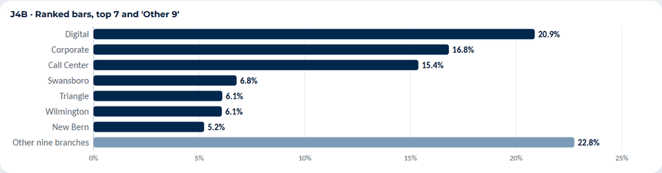
**J4B, ranked bars of the top seven and "other nine".**

| Style | Acc | Leg | Marks | Label | Col | Hon | So-what | Drill | Cost | Score |
|---|---|---|---|---|---|---|---|---|---|---|
| J4A Donut with 16-row legend (shipped logic) | 1 | 2 | 1 | 2 | 1 | 3 | 1 | 2 | 5 | **36** |
| J4B Ranked bars, top 7 and 'other nine' | 5 | 5 | 4 | 5 | 5 | 4 | 5 | 4 | 3 | **92** |
| J4C Treemap of all 16 | 2 | 3 | 2 | 2 | 3 | 4 | 3 | 3 | 2 | **56** |
| J4D Single 100% bar, top four named | 4 | 4 | 5 | 4 | 4 | 5 | 4 | 2 | 3 | **82** |

Other images: [J4C](chart-styles/J4C.png), [J4D](chart-styles/J4D.png).

**Finding.** The donut does not survive more than about five parts, which matches the "about five" in the Datawrapper snippet and Wilke's three to five. Today the donut renderer has no cap. **Default: J4B**, grouping the tail as "other" and saying so. J4D is the compact option when only the concentration matters ("four branches open 60% of new accounts").

### Job 5. A monthly trend against a goal

*Question: is referral volume at or over the goal, and since when?* Data: ICS referrals by month against the goal, Aug 25 to Sep 26 (`ics-trend`); the goal is 85 until Jan 26, then 80.

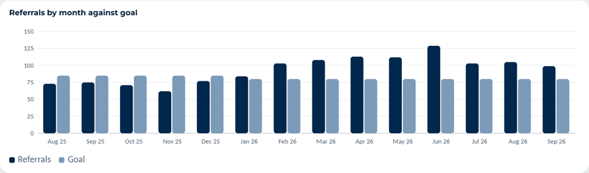
**J5A, as shipped:** referrals and goal as paired columns, no value labels.

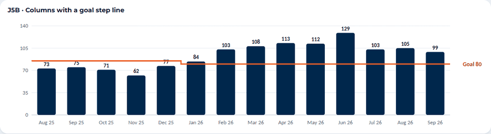
**J5B, columns with a goal step line.**

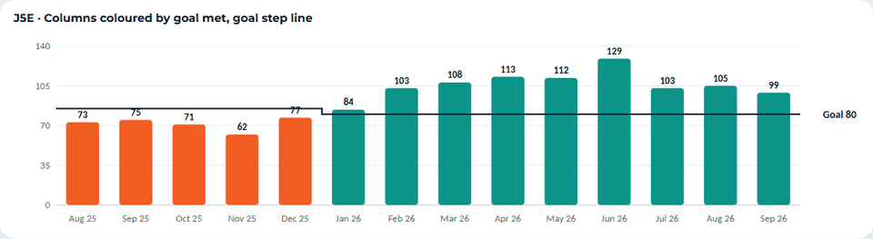
**J5E, the same with columns coloured by goal met** (teal) or missed (orange).

| Style | Acc | Leg | Marks | Label | Col | Hon | So-what | Drill | Cost | Score |
|---|---|---|---|---|---|---|---|---|---|---|
| J5A Paired columns, referrals beside goal (shipped) | 4 | 3 | 2 | 3 | 3 | 5 | 3 | 3 | 5 | **69** |
| J5B Columns with a goal step line | 5 | 5 | 4 | 5 | 5 | 5 | 5 | 3 | 4 | **95** |
| J5C Line against a goal line | 5 | 4 | 4 | 5 | 5 | 4 | 4 | 2 | 4 | **84** |
| J5D Variance bars, referrals minus goal | 5 | 5 | 4 | 5 | 4 | 4 | 5 | 3 | 2 | **87** |
| J5E Columns coloured by goal met, with the step line | 5 | 5 | 4 | 5 | 4 | 5 | 5 | 3 | 3 | **92** |
| J5F Area under the line, goal line | 3 | 4 | 4 | 4 | 5 | 3 | 3 | 2 | 4 | **71** |

Other images: [J5C](chart-styles/J5C.png), [J5D](chart-styles/J5D.png), [J5F](chart-styles/J5F.png).

**Finding.** A goal is a standard, not a second series: drawn as a bar beside every month it doubles the marks (28 bars) and the steel goal bar is 2.9:1 against white. A line makes "over or under" a single glance and shows the goal moving from 85 to 80 as a step. The area chart fails an honesty rule: a month that is left out would be filled across, and the project states a left-out month instead of drawing through it. Variance bars (J5D) read well but drop the level and need the difference computed in the pack. **Default: J5B.** J5E adds colour where the "met" rule is the message; it passes the colour-vision simulation (orange against teal stays distinct, section 5).

### Job 6. Before and after a mailing, two groups

*Question: did responders change their debit spend more than members who did not respond?* Data: monthly debit spend per account before and after the Jul 2026 mailing; responders $558 to $1,013, mailed with no response $293 to $299 (`resp-chart`).

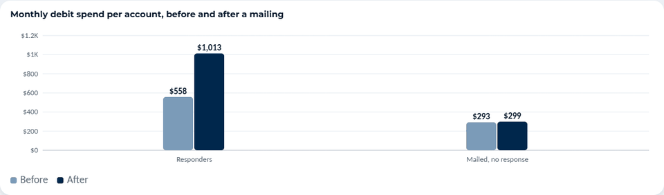
**J6A, as shipped:** paired columns.

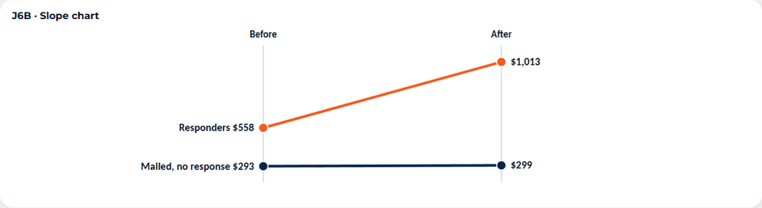
**J6B, slope chart.**

| Style | Acc | Leg | Marks | Label | Col | Hon | So-what | Drill | Cost | Score |
|---|---|---|---|---|---|---|---|---|---|---|
| J6A Paired columns (shipped) | 4 | 5 | 5 | 4 | 4 | 5 | 3 | 3 | 5 | **85** |
| J6B Slope chart | 5 | 4 | 5 | 4 | 5 | 4 | 5 | 2 | 3 | **87** |
| J6C Dumbbell, one row per group | 5 | 4 | 5 | 5 | 5 | 4 | 4 | 2 | 3 | **85** |
| J6D Change bars (dollars and per cent added) | 5 | 5 | 5 | 5 | 5 | 4 | 5 | 2 | 2 | **91** |

Other images: [J6C](chart-styles/J6C.png), [J6D](chart-styles/J6D.png).

**Finding.** With two groups and four numbers the shipped chart is fine and the scores sit within six points of each other, which is inside my margin of error. The styles differ in what they ask the presenter to say. Paired columns make the viewer subtract; the slope (steep against flat) and the change bars (+$455 against +$6) show the answer. The change bars need two derived figures (the dollars and per cent added) through `Tracer.derive`, and the movement words must follow the +/-2% band (the control moved +2.0%, which is on the band's edge). **Keep the shipped chart; add a single annotation of the change on the responder bars.** The slope chart is worth building only if before/after charts with more groups arrive.

### Job 7. Where the client stands among 52 peers

*Question: is the client ahead of or behind the other CashPlease clients?* Data: loans per 1,000 DDAs, last 12 months; Marine FCU 40.5, 10th of 53, 230.8% above the peer median of 12.2 (`strip-per_1k`). Peer values are anonymous.

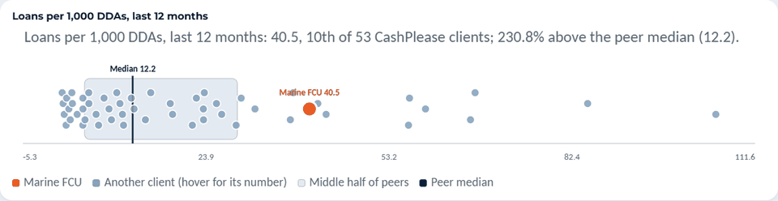
**J7A, as shipped:** a strip plot with the middle-half band and median tick.

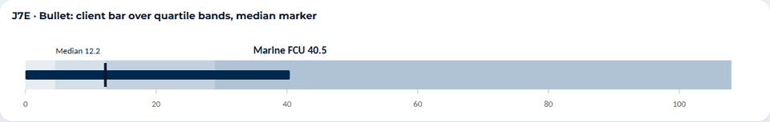
**J7E, a bullet:** the client bar over quartile bands with the median marker.

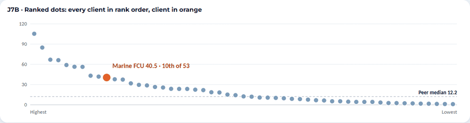
**J7B, every client in rank order,** the client in orange.

| Style | Acc | Leg | Marks | Label | Col | Hon | So-what | Drill | Cost | Score |
|---|---|---|---|---|---|---|---|---|---|---|
| J7A Strip plot, quartile band, median tick (shipped) | 4 | 3 | 2 | 4 | 3 | 4 | 3 | 2 | 5 | **66** |
| J7B Ranked dots, every client in rank order | 5 | 4 | 2 | 5 | 3 | 5 | 5 | 2 | 3 | **81** |
| J7C Range bar: 10th to 90th, quartiles, median, client | 4 | 5 | 5 | 4 | 4 | 3 | 4 | 2 | 2 | **78** |
| J7D Histogram with the client's bin marked | 4 | 4 | 4 | 4 | 3 | 4 | 4 | 2 | 4 | **76** |
| J7E Bullet: client bar over quartile bands | 4 | 5 | 5 | 4 | 5 | 4 | 4 | 2 | 3 | **84** |
| J7F One sentence and one number | 5 | 5 | 5 | 5 | 5 | 5 | 3 | 1 | 5 | **89** |

Other images: [J7C](chart-styles/J7C.png), [J7D](chart-styles/J7D.png), [J7F](chart-styles/J7F.png).

**Finding.** The shipped strip has 52 steel dots that overlap, a jitter that hides some of them, a client label that sits on a dot, and an axis that starts at -5.3 for a count that cannot be negative, with ticks at 23.9, 53.2 and 82.4 (the axis is padded from the data range and ticks are not rounded; `stripSVG`). The steel dots are 2.9:1 against white. The sentence (J7F) is the headline and the screen already has it in `psent`; it is not a chart, so its high score reflects accuracy of the printed number, not a picture of the spread. A bullet (J7E) uses only figures already in the model (client, median and the two quartiles) and is read at a glance. Ranked dots (J7B) show the shape (a long right tail) and the rank directly and suit the "show me every client" follow-up. **Default: the sentence over J7E; J7B on a keypress.** Drop the jittered strip.

### Job 8. Peer position with only five peers

*Question: where does Marine FCU's Reg E opt-in sit among REMS clients?* Data: opt-in rate by month, Oct 2026: 83.0%, 4th of 6, 7.1% below the peer median of 89.3% (`strip-pct_opt_in`).

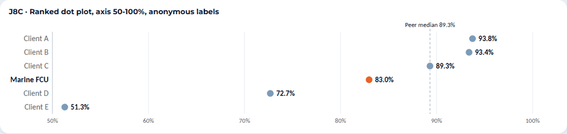
**J8C, ranked dots** with anonymous labels ("Client A").

| Style | Acc | Leg | Marks | Label | Col | Hon | So-what | Drill | Cost | Score |
|---|---|---|---|---|---|---|---|---|---|---|
| J8A Strip plot with quartile band, five peers | 4 | 3 | 4 | 4 | 3 | 2 | 3 | 2 | 5 | **64** |
| J8B Six ranked bars, anonymous labels | 4 | 5 | 5 | 5 | 4 | 4 | 4 | 2 | 3 | **83** |
| J8C Ranked dot plot, 50-100% axis, anonymous labels | 5 | 5 | 5 | 5 | 3 | 4 | 5 | 2 | 3 | **87** |

Other images: [J8A](chart-styles/J8A.png), [J8B](chart-styles/J8B.png).

**Finding.** A "middle half" band drawn from five values is not a distribution and looks like one (J8A scores 2 on honesty). With five peers every value can be shown. The existing rule (fewer than five peers is not shown) is the right floor; I would add a second one: below about eight peers, draw the ranked list and no band. The "about eight" is my judgement; the sources give no threshold. **Default: J8C**, with "Client A to E" labels so no peer is identifiable.

### Job 9. Two measures per branch

*Question: which branches are weak on both debit take and Reg E opt-in?* Data: `score-quadrant`, 29 branches sized by eligible accounts. The connected scatter (J9D) uses a different real pair, since the page has no monthly series per branch: REMS responses against opt-in rate by month.

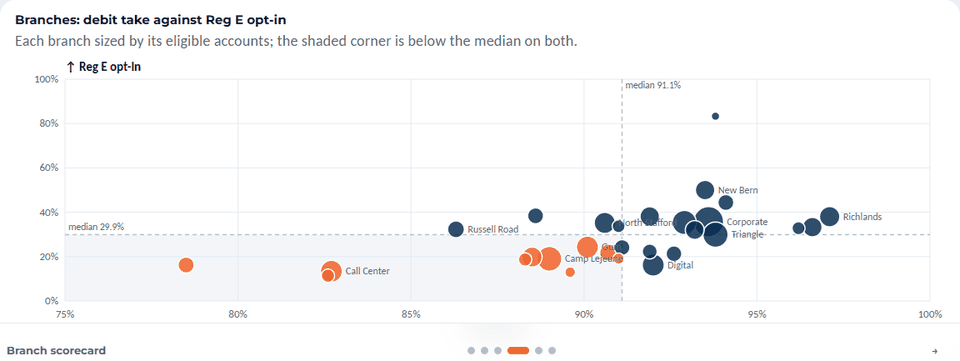
**J9A, as shipped.**

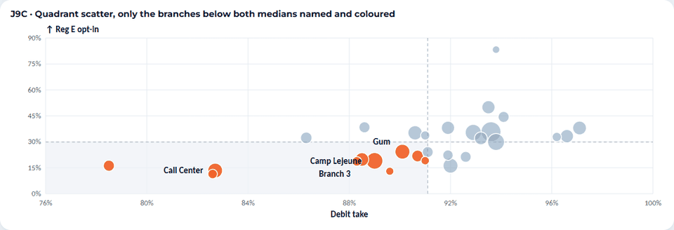
**J9C, the same quadrant with only the below-both set coloured and named.**

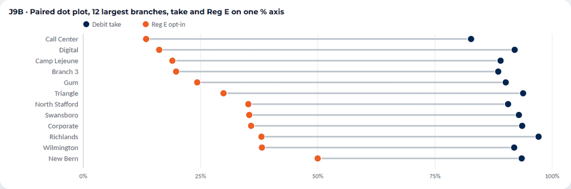
**J9B, paired dot plot** of the 12 largest branches on one percentage axis.

| Style | Acc | Leg | Marks | Label | Col | Hon | So-what | Drill | Cost | Score |
|---|---|---|---|---|---|---|---|---|---|---|
| J9A Quadrant scatter, medians, large points named (shipped) | 4 | 3 | 2 | 2 | 4 | 3 | 4 | 3 | 5 | **67** |
| J9B Paired dot plot, 12 largest branches | 5 | 4 | 3 | 5 | 4 | 3 | 4 | 4 | 3 | **78** |
| J9C Quadrant scatter, only the low-on-both named and coloured | 4 | 4 | 3 | 3 | 4 | 4 | 5 | 3 | 4 | **79** |
| J9D Connected scatter (monthly pair, 18 months) | 2 | 3 | 2 | 2 | 4 | 4 | 1 | 1 | 3 | **51** |

Other images: [J9D](chart-styles/J9D.png).

**Finding.** The shipped quadrant is the right form for "low on both" and is already built. Its weakness is labels: it names up to 16 branches at 12 px and several sit on top of one another ("North Stafford" is cut by a dot; "Camp Lejeune" and "Gum" collide). Colouring and naming only the branches below both medians (the decision) removes most of that. The paired dot plot answers a different question (how far apart the two rates are) and only for the 12 largest branches, so it hides small branches. The connected scatter is 18 crossing segments with no trend to follow, which is what source 11 warns about; it is not a fit for monthly series that bounce. One gallery lesson: an axis domain that clips a point (my first pass cut Call Center) is an honesty failure, so a scatter's domain must come from all the points. **Default: J9C.**

### Job 10. One mix, three measures, eight swipe tiers

*Question: how do spend, accounts and NSF/OD items compare across the swipe tiers?* Data: the three metrics of `usage-chart`; shares are each tier's part of the column total ($48.8M spend, 36,592 accounts, 11,784 items).

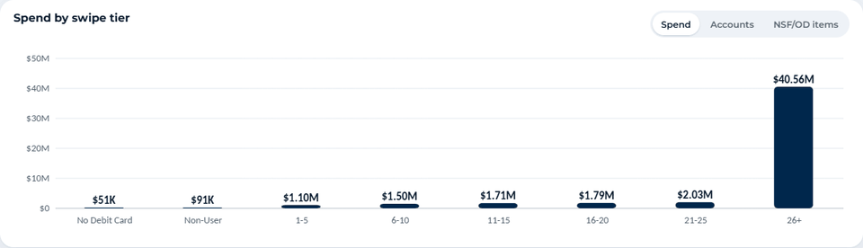
**J10A, as shipped:** one measure at a time with a toggle (spend is shown).

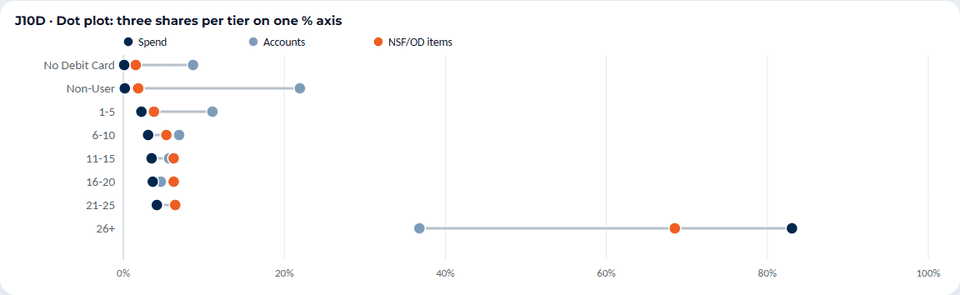
**J10D, a dot plot** with three shares per tier on one percentage axis.

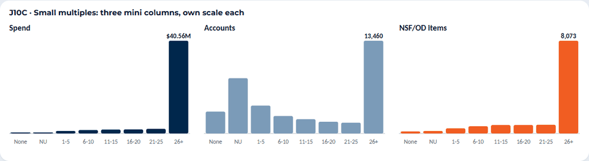
**J10C, small multiples** (three panels, own scale each).

| Style | Acc | Leg | Marks | Label | Col | Hon | So-what | Drill | Cost | Score |
|---|---|---|---|---|---|---|---|---|---|---|
| J10A One measure at a time with a toggle (shipped) | 4 | 5 | 4 | 5 | 5 | 4 | 2 | 4 | 5 | **81** |
| J10B Grouped bars: share of each total, three per tier | 4 | 3 | 2 | 3 | 3 | 5 | 4 | 3 | 2 | **69** |
| J10C Small multiples, three panels | 4 | 3 | 2 | 3 | 5 | 5 | 3 | 3 | 3 | **72** |
| J10D Dot plot: three shares per tier on one axis | 5 | 4 | 3 | 4 | 3 | 5 | 5 | 3 | 2 | **82** |
| J10E Index to the average account | 4 | 3 | 3 | 3 | 3 | 4 | 5 | 3 | 2 | **72** |
| J10F Three 100% stacked bars | 2 | 2 | 2 | 3 | 2 | 5 | 3 | 1 | 3 | **54** |

Other images: [J10B](chart-styles/J10B.png), [J10E](chart-styles/J10E.png), [J10F](chart-styles/J10F.png).

**Finding.** The shipped headline says the 26+ tier is 36.8% of accounts and 83.1% of spend, and the chart shows one of those two numbers at a time: the viewer must flip the toggle and remember. The dot plot puts the three shares for each tier on one axis, so the 26+ row shows the whole story (37% of accounts, 69% of NSF/OD items, 83% of spend) and the other rows sit in a cluster. Small multiples (source 10) are accurate but small: 24 bars at 11.5 px labels. Eight-segment stacked bars are the weakest here (source 5 on stacked bars). The toggle remains the right drill-down. **Default: J10D, with the existing toggle kept beside it.** The shares are new figures (see section 7, item 9).

### Job 11. KPI tiles

*Question: what is the one number, and is it good?* Data: the ARS summary tiles (profitability 5.3 : 1 against the 2 : 1 guaranteed minimum; September revenue $139,162 with twelve monthly values), and ICS referrals 99 against a goal of 80. Targets exist for only these two of the tiles tried.

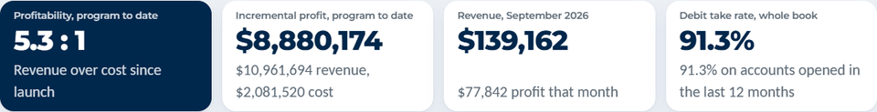
**J11A, as shipped.**

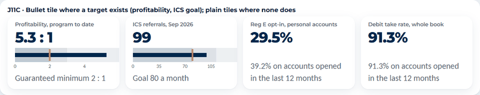
**J11C, bullet strips where a target exists,** plain tiles where none does.

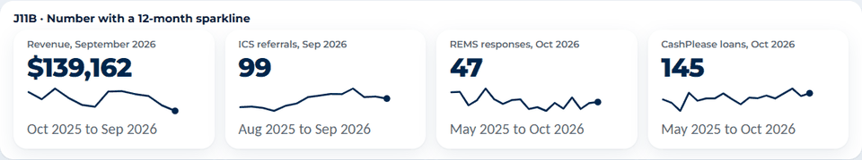
**J11B, number plus a 12-month sparkline.**

| Style | Acc | Leg | Marks | Label | Col | Hon | So-what | Drill | Cost | Score |
|---|---|---|---|---|---|---|---|---|---|---|
| J11A Number, label, one-line sub (shipped) | 5 | 5 | 5 | 5 | 5 | 5 | 2 | 5 | 5 | **91** |
| J11B Number with a 12-month sparkline | 4 | 4 | 4 | 5 | 5 | 3 | 4 | 4 | 3 | **79** |
| J11C Bullet tile where a target exists | 5 | 4 | 4 | 4 | 5 | 5 | 5 | 4 | 3 | **91** |
| J11D Number, bullet and sparkline mixed | 4 | 4 | 3 | 4 | 5 | 3 | 4 | 4 | 3 | **76** |

Other images: [J11D](chart-styles/J11D.png).

**Finding.** The shipped tile scores high because an exact number in 54 px type is hard to misread; its weakness is that "5.3 : 1" sits there with no scale (the "good" is in the sub-line). A bullet, as Few specifies, adds the target and the range in one strip and keeps the number. It applies to two tiles, so the cost is small. Sparklines scored lower on honesty because each one is scaled to its own minimum and maximum, which makes a 12% revenue change look like a collapse; they need a zero or a stated range before they go on a tile. **Default: keep the number tile; add the bullet where a target exists (profitability, ICS goal).**

## 5. Colour and legibility, measured

### Contrast of the chart tokens (WCAG 1.4.11, 3:1 for a mark that carries meaning)

Computed from `live.css`; light theme against white `#FFFFFF`, dark theme against `#11233A`.

| Token | Light | Dark |
|---|---|---|
| navy | 15.06 : 1 | 5.42 : 1 |
| orange | 3.32 : 1 | 6.13 : 1 |
| teal | 3.74 : 1 | 6.44 : 1 |
| tick grey | 5.88 : 1 | 7.14 : 1 |
| **steel** | **2.91 : 1** (below 3:1) | 5.45 : 1 |
| **gold** | **2.07 : 1** (below 3:1) | 7.65 : 1 |
| **axis grey** | **1.84 : 1** (gridline use only) | 2.53 : 1 |

Steel carries meaning in the peer dots, the goal bar, the "before" bars and the third donut slice; gold is the fifth donut slice. In the shipped donut's palette order, orange next to steel is 1.14 : 1, steel next to teal 1.29 : 1 and teal next to gold 1.81 : 1, so adjacent slices rely on the 2 px gap and the legend, not on contrast. A steel of `#7595B3` would clear 3:1 (3.13 : 1) and stay 46 apart from navy in CIE76 colour difference.

### Distance between the colour pairs the gallery uses, under simulated colour-vision deficiency

CIE76 colour difference (about 20 or more is easy to tell apart, under 10 is hard); simulation uses the Machado et al. (2009) matrices at full severity.

| Pair | Normal | Deuteranopia | Protanopia | Tritanopia |
|---|---|---|---|---|
| navy / orange | 108.8 | 103.4 | 82.7 | 104.2 |
| navy / steel | 48.5 | 48.7 | 47.6 | 45.9 |
| orange / steel | 97.6 | 82.0 | 69.5 | 101.4 |
| orange / teal | 109.2 | 69.1 | 50.0 | 116.0 |
| navy / teal | 60.3 | 45.4 | 48.6 | 44.6 |
| **orange / gold** | 44.2 | **12.3** | 23.4 | 44.0 |
| teal / gold | 83.2 | 71.7 | 63.4 | 77.1 |
| **steel / teal** | 35.7 | **16.1** | 19.8 | 17.7 |

Navy with orange, the pair most charts use, holds up under all three. Orange with teal (goal missed or met in J5E) also holds. **Orange with gold collapses under deuteranopia** and steel with teal is weak in all three, so gold and steel should not both appear where a viewer must tell them apart. Simulated captures: [`J5E-deut.png`](chart-styles/J5E-deut.png), [`J4A-deut.png`](chart-styles/J4A-deut.png), [`J3A-deut.png`](chart-styles/J3A-deut.png), [`J10D-deut.png`](chart-styles/J10D-deut.png), [`J10B-deut.png`](chart-styles/J10B-deut.png), [`J9B-deut.png`](chart-styles/J9B-deut.png), [`J1C-deut.png`](chart-styles/J1C-deut.png), [`J3E-deut.png`](chart-styles/J3E-deut.png). The dark theme was not rendered.

### Legibility over a share

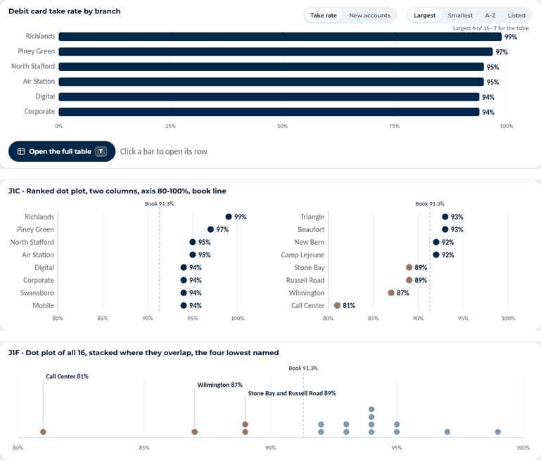

The image scales the 1280 x 720 captures to 854 px wide and compresses them as JPEG at quality 35: the shipped take-rate bars, the gallery dot plot (J1C) and the stacked dot strip (J1F). It is a rough stand-in for a viewer on a smaller stage or a 480p stream, not a measurement of Teams. At that scale the 13 px axis ticks and 12 px labels become about 8 to 9 px and are barely readable; the 16 px category labels and 15 px values hold. Two conclusions follow, both cautious: the shipped value and category sizes are adequate, and the axis ticks, the "median" and "book" labels and legend text (12 to 13 px) are the weak point in every style. Sources 12 and 13 and the forum thread (18) support the direction (keep marks few, avoid fine detail) but not a number.

## 6. One default per job

| Job | Default | Offer as an alternative when | Why |
|---|---|---|---|
| 1. Compare branches on a rate | **J1C** ranked dots, non-zero labelled axis, book line | J1E gap-to-book to speak in points; shipped bars when values span most of the scale | Position on a common scale; uses the space for the difference; all 16 fit |
| 2. Compare 32 branches | **Shipped bars, lowest first, median line** (J2D as dots) | J2B strip when the shape matters | Cannot draw 32 legibly; show the end the decision is about |
| 3. Parts of a whole, up to eight parts | **J3C** ranked bars with share labels | Donut for four parts or fewer with one dominant part; J3B single bar for "how concentrated" | Shares compared on one scale; already a shipped block |
| 4. Parts of a whole, many parts | **J4B** top seven and "other" | J4D single 100% bar | A donut past about five parts fails |
| 5. Trend against a goal | **J5B** columns with a goal step line | J5E when "met or missed" is the message; J5D variance bars as a drill | One mark per month and one standard |
| 6. Before and after, two groups | **Shipped paired columns** plus a change annotation | J6B slope for more groups | Scores are close; the annotation adds the answer |
| 7. Peer position, 20 or more peers | **Sentence over J7E bullet** | J7B ranked dots on a keypress | Few marks, uses figures already in the model |
| 8. Peer position, five to seven peers | **J8C** ranked dots, anonymous labels | J8B bars | No band from five values |
| 9. Two measures per branch | **J9C** quadrant with only the low-on-both set named | J9B paired dots for "how far apart" | The decision is who is low on both |
| 10. A mix across categories on three measures | **J10D** three-share dot plot | The shipped toggle as the drill-down; J10C small multiples for a larger screen | Puts the headline's two numbers on one axis |
| 11. KPI tiles | **Number tile; add a bullet where a target exists** | Sparkline when it has a zero or a stated range | Keeps the tile; adds the standard |

Conditions for keeping the donut (it was added at Aaron's request on 2026-11-03, and the evidence argues against it only as a default): four parts or fewer, one clearly dominant part, parts sorted largest first, direct labels with values, a palette that does not repeat, and the smallest part still readable (otherwise use J3C).

## 7. Changes to Live Review, in priority order

Effort: **S** is up to half a day, **M** one to two days, **L** three or more. Every change that shows a figure the pack does not already hold needs the figure computed in Python with `Tracer.derive` (so `audit` can trace it), a test, and a CHANGELOG entry; those are counted in the estimate. Browser-computed values (a share in a tooltip, as the donut does today) are not traced and I would not add more.

| # | Change | Evidence | Where | Effort |
|---|---|---|---|---|
| 1 | **Open decision charts on the end the decision is about**, say so ("Lowest 6 of 16"), and add the book or median as a reference line on branch bar charts (take, Reg E, attrition, value per account). Today present mode opens on the largest. | J1A, J2A, J2D | `sortOf`, `barsSVG` in `live.js`; a `sort` and `ref` option on `blocks.bars`; the program modules that build those charts | M (1 day) |
| 2 | **Donut guard:** more than five parts falls back to ranked bars with an "Other" row; a palette with no repeats; keep the donut for four parts or fewer. | J4A, J3A | `donutSVG`, `PAL`; `blocks.donut` | S (0.5 day) |
| 3 | **Fix the chart tokens:** steel to at least 3:1 (`#7595B3` clears it), drop gold from the categorical palette, add a 1.5 px surface-coloured border on slices and dots, keep orange and gold out of the same legend. | Section 5 | `live.css` tokens, `PAL`; the dark theme needs no change | S (0.5 day) |
| 4 | **Present-mode type floor:** axis ticks, median and book labels and legend text from 12 or 13 px to 15 px. | Section 5 | `html.present .chart text` in `live.css`; check chart widths with the longer labels | S (0.5 day) |
| 5 | **Goal as a line, not a bar:** a `goal` series type drawn as a step line, with an option to colour columns met or missed; use it for ICS referrals and any other monthly measure with a goal. Value labels on every column. | J5A, J5B, J5E | `barsSVG`, `blocks.bars`, `programs/ics.py`; goal values are already in the pack (no new figure) | M (1.5 days) |
| 6 | **Peer strip:** replace the jittered strip with the bullet (client bar over the existing quartiles, median marker) and the ranked-dot view on a keypress; draw no band below about eight peers (ranked dots with "Client A" labels instead); fix the axis so a non-negative measure never starts below zero and ticks are round. | J7A, J7B, J7E, J8A, J8C | `stripSVG`, `peerstrip` block; `peers.py`; uses `q1`, `q3`, `median`, `dots` already in the model | M (2 days); the axis fix alone is S |
| 7 | **Dot style for rates on a bar block:** `style: "dot"` with a labelled non-zero axis and optional two-column layout, allowed only for dots (a test fails a bar block with a non-zero start). Use it for take rate and Reg E by branch. | J1C, J1E | `barsSVG`, `blocks.bars`, `tests` | M (2 days) |
| 8 | **Quadrant labelling:** name and colour only the points below both medians; keep the rest grey and unlabelled; make the axis domain come from all points. | J9A, J9C | `scatterSVG` | S (0.5 day) |
| 9 | **Share-of-total view for the swipe-tier mix:** a three-measure dot plot next to the existing toggle (spend, accounts, NSF/OD items as shares of their totals). Shares are new figures. | J10A, J10D | `programs/ars.py` computes them with `Tracer.derive`; a new `dots` block or the dot style from item 7 | M (2 days) |
| 10 | **Bullet strip on KPI tiles that have a target** (profitability against the 2 : 1 minimum; ICS referrals against the goal): a `target` on the `kpi` block, and no bullet where none exists. Sparklines only with a zero or stated range. | J11A, J11C | `kpisHTML`, `blocks.kpi`, `programs/ars.py`, `programs/ics.py` | M (1 day) |
| 11 | **Change annotation on before/after:** "+$455 (81.5%)" on the responder columns, worded to the +/-2% band; the change is derived in the pack. | J6A, J6D | `programs/analysis.py`; `barsSVG` annotation | S (0.5 day) |
| 12 | **Presenter highlight (a key that colours one branch, bar or segment and greys the rest).** Not tried in the gallery; supported by sources 5 and 9 (all grey, colour the point). Lowest priority. | Sources 5, 9 | `live.js` state and keys | M (2 days) |

Not recommended, and why: a **treemap** (J3D, J4C; area ranks below position and length, and the smallest rectangles go unlabelled), a **waffle** (J3E; whole-percent squares, 100 marks), a **connected scatter** on bouncing monthly series (J9D), an **area chart** for any series that can have a left-out month (J5F), a **16-part donut** (J4A), and **stacked bars with more than four segments** (J10F). None of these is in Live Review today except the donut, which is covered by item 2.

## 8. What could not be verified

- **Cleveland and McGill** was read through a university slide deck and the Heer and Bostock replication, not the 1984 paper. Heer and Bostock's results tables did not extract; I relied on their abstract and a secondary summary for the ranking.
- **Tufte** was read through Wilke's chapter and secondary pages, not his books. Few's *Information Dashboard Design* and Cowan (2001) are known to me only through summaries.
- **Datawrapper's "about five slices"** came from a search snippet of its academy; the pie and donut pages I could open did not state a number. Knaflic's pie posts were seen as search summaries.
- **Teams:** no Microsoft document states how a shared screen is compressed. The simulation is mine (downscale and JPEG), and the forum thread is anecdote. **No test was run on a 36 inch monitor or in a real call.**
- **Font sizes:** the only sources found were vendor blog posts. The size changes in section 7 follow from my own downscale test, not from a citation.
- **Scores** are my judgement against the rubric, one scorer, no viewers. Differences under about six points should be read as ties.
- **Colour-vision simulation** applies the Machado matrices in sRGB space through an SVG filter and, for the numbers, in linear RGB; it approximates, and the dark theme was not rendered.
- **Peer percentiles:** the 10th and 90th percentiles in J7C were computed by me from the 52 anonymous values; they are not in the pack.
- **One client, one month.** Marine FCU October 2026 is the only data used. The 4,430 accounts in J4 omit five accounts at branches the screen does not list (the shipped screen says so).
- **Browsers:** Chrome only.

## 9. How the gallery was made

The gallery is a standalone page that draws the real Marine FCU view model (built with `registry.build_model('1539', '2026.10')`, 0 untraced figures) in the alternative styles, using the same `scaleFor`, `axisLabel` and `textW` helpers copied from `live.js`, the same `live.css` tokens and the bundled Carlito and Montserrat fonts, at the present-mode chart width of 1116 px. The shipped images are element screenshots of the running page (`scripts/live_review.py 1539 --period 2026.10 --no-open`, 127.0.0.1 only, share read-only, `?present=1`, 1280 x 720). Screenshots were taken with headless Chrome driven through Playwright over a debugging port on a random port with its own profile; the process tree was killed afterwards. Peer values carry no ids. The gallery source, the model dump and the scripts stay in the session scratch folder and are not committed; `docs/chart-styles/` holds the PNGs only, scaled to 960 px wide and quantised to 128 colours (under 1 MB in all).
